<!--
  You read the raw source. Respect.
  Open an issue titled 'ping-from-the-source' and say hi.
-->

  <!-- Hero header: green cinema-spotlight GradientASCII + Liquid Glass name, SplitText professions, & Iconify social icons (scripts/hero_header.py) -->
  <a href="https://dott.bio/uzairshahid" target="_blank" rel="noopener noreferrer" title="Muhammad Uzair (@uzairshahidgithub) — Cyber Security Engineer, Security Researcher, Open Source Developer, Self Designer, DevSecOps, Linux System Administration &amp; AI Automation Engineer">
    <picture>
      <source media="(prefers-color-scheme: dark)" srcset="assets/hero-header.svg" />
      <source media="(prefers-color-scheme: light)" srcset="assets/hero-header-light.svg" />
      
    </picture>
  </a>

 

  <!-- Linked map: generated by .github/workflows/contribution-map.yml -> assets/contribution-map.svg -->
  

 

  <!-- Total Contributions counter: React Bits CountUp odometer (scripts/contributions_count.py) -->
  <picture>
    <source media="(prefers-color-scheme: dark)" srcset="assets/contributions-count.svg" />
    <source media="(prefers-color-scheme: light)" srcset="assets/contributions-count-light.svg" />
    
  </picture>

  

  <!-- Tech stack marquee: React Bits LogoLoop style (scripts/tech_loop.py) -->
  <picture>
    <source media="(prefers-color-scheme: dark)" srcset="assets/tech-loop.svg" />
    <source media="(prefers-color-scheme: light)" srcset="assets/tech-loop-light.svg" />
    
  </picture>

 

  <!-- Followers section: React Bits ShinyText heading + curved Text Path followers (scripts/followers_path.py + .github/workflows/followers-path.yml) -->
  <picture>
    <source media="(prefers-color-scheme: dark)" srcset="assets/followers-heading.svg" />
    <source media="(prefers-color-scheme: light)" srcset="assets/followers-heading-light.svg" />
    
  </picture> 
  <a href="https://github.com/uzairshahidgithub?tab=followers" target="_blank" rel="noopener noreferrer" title="GitHub Followers of Muhammad Uzair (@uzairshahidgithub)">
    <picture>
      <source media="(prefers-color-scheme: dark)" srcset="assets/followers-path.svg" />
      <source media="(prefers-color-scheme: light)" srcset="assets/followers-path-light.svg" />
      
    </picture>
  </a>

  

<!-- REPO_WHEEL_START -->

  <!-- Repository OptionWheel: only active white centered item is clickable on GitHub (scripts/repo_wheel.py) -->
  <picture><source media="(prefers-color-scheme: dark)" srcset="assets/wheel-0.svg" /><source media="(prefers-color-scheme: light)" srcset="assets/wheel-0-light.svg" /></picture> 
  <picture><source media="(prefers-color-scheme: dark)" srcset="assets/wheel-1.svg" /><source media="(prefers-color-scheme: light)" srcset="assets/wheel-1-light.svg" /></picture> 
  <picture><source media="(prefers-color-scheme: dark)" srcset="assets/wheel-2.svg" /><source media="(prefers-color-scheme: light)" srcset="assets/wheel-2-light.svg" /></picture> 
  <picture><source media="(prefers-color-scheme: dark)" srcset="assets/wheel-3.svg" /><source media="(prefers-color-scheme: light)" srcset="assets/wheel-3-light.svg" /></picture> 
  <a href="https://github.com/uzairshahidgithub/Fedora-Security-Automation" target="_blank" rel="noopener noreferrer" title="Fedora-Security-Automation — A clean, lightweight, error-free automated malware and rootkit detection system that brings zero-cost enterprise security to Fedora Linux."><picture><source media="(prefers-color-scheme: dark)" srcset="assets/wheel-4.svg" /><source media="(prefers-color-scheme: light)" srcset="assets/wheel-4-light.svg" /></picture></a> 
  <picture><source media="(prefers-color-scheme: dark)" srcset="assets/wheel-5.svg" /><source media="(prefers-color-scheme: light)" srcset="assets/wheel-5-light.svg" /></picture> 
  <picture><source media="(prefers-color-scheme: dark)" srcset="assets/wheel-6.svg" /><source media="(prefers-color-scheme: light)" srcset="assets/wheel-6-light.svg" /></picture> 
  <picture><source media="(prefers-color-scheme: dark)" srcset="assets/wheel-7.svg" /><source media="(prefers-color-scheme: light)" srcset="assets/wheel-7-light.svg" /></picture> 
  <picture><source media="(prefers-color-scheme: dark)" srcset="assets/wheel-8.svg" /><source media="(prefers-color-scheme: light)" srcset="assets/wheel-8-light.svg" /></picture>

 

  <a href="https://uzairshahidgithub.github.io/uzairshahidgithub/" target="_blank" rel="noopener noreferrer" title="Open Interactive Repository Wheel &amp; Portfolio for Muhammad Uzair (@uzairshahidgithub)"><picture><source media="(prefers-color-scheme: dark)" srcset="assets/wheel-launch.svg" /><source media="(prefers-color-scheme: light)" srcset="assets/wheel-launch-light.svg" /></picture></a>

<!-- REPO_WHEEL_END -->
